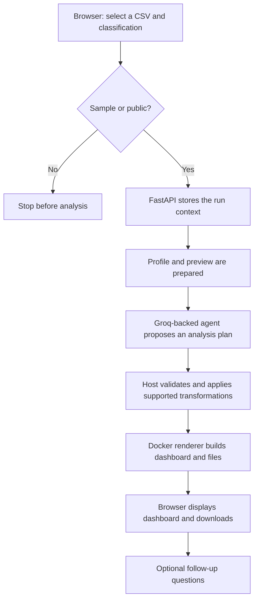

# Fieldnote | Local CSV analysis workspace

Fieldnote turns an approved CSV into a data quality profile, a reviewed exploratory analysis, an interactive dashboard, and a set of downloadable files. It combines a browser interface with a local Python service and a separate command-line workflow.

> **Project lineage:** This submission adapts work originally created by **[author name]** and shared with permission. Original project or repository: **[link]**. The interface and project documentation have been redesigned for this submission. Replace the bracketed details with the author’s preferred credit before submitting.

## What it does

- Accepts CSV uploads up to 25 MB through a local browser interface.
- Requires each uploaded dataset to be classified as sample/synthetic or explicitly public. Private and unknown data are rejected before analysis.
- Profiles columns, missing values, duplicates, and numeric distributions. The agent receives an aggregate profile and a reproducible preview of up to ten rows; the full CSV remains in the local run context for the analysis tool.
- Produces a validated plan for supported data cleanup, including missing-value handling, selected type conversions, IQR outlier capping, and exact duplicate removal. The original dataset is preserved.
- Builds a standalone interactive Plotly dashboard, a report, a profile, a transformed CSV, a transformation log, and SVG chart downloads. The dashboard summarizes the full dataset and supports cross-filtering where the chart types allow it.
- Runs chart rendering in a local Docker container with networking disabled and a read-only root filesystem. The renderer’s temporary workspace and `/tmp` remain writable.
- Provides a separate CLI workflow for a bundled CSV, PostgreSQL query results, or API JSON data. Database and API credentials stay on the host; hosted analysis accepts only sample or explicitly public data.

This project performs exploratory data analysis. It does not train a model or create a train/test split.

## How a browser analysis runs



The browser sends uploads to the local FastAPI service. The local agent uses Groq through the host process. Only a validated plan is applied to a copy of the data, then that data and the requested charts are passed to the isolated renderer. The separate CLI uses the LangSmith Managed Deep Agent runtime and does not share the browser flow.

## Technology

| Area | Tools |
| --- | --- |
| Browser interface | HTML, CSS, vanilla JavaScript |
| Local API | Python, FastAPI, Uvicorn |
| Local agent | LangChain Agents, TodoListMiddleware, Groq |
| Hosted CLI agent | LangSmith Managed Deep Agents, LangGraph SDK |
| Data work | Pandas, Pydantic |
| Charts and exports | Plotly, Kaleido |
| Renderer isolation | Docker, Chromium |

## Run locally

### Requirements

- Python 3.11 or 3.12
- [uv](https://docs.astral.sh/uv/)
- Docker Desktop
- A Groq API key for browser analysis
- LangSmith credentials only for tracing or the separate hosted CLI

From the repository root, install the Python environment and create the local environment file:

```powershell
uv sync
Copy-Item .env.example .env
```

Set `GROQ_API_KEY` in `.env`, then build the renderer image:

```powershell
docker build -f sandbox/Dockerfile -t data-agent-eda:checkpoint .
```

Start the API in one PowerShell terminal:

```powershell
uv run uvicorn scripts.web_app:app --host 127.0.0.1 --port 8000
```

Serve the browser files from the `Design a polished CSV analytics frontend for a Python data analyst agent` directory in a second terminal:

```powershell
python -m http.server 4173 --bind 127.0.0.1 --directory "Design a polished CSV analytics frontend for a Python data analyst agent"
```

Check that [the API health endpoint](http://127.0.0.1:8000/api/health) reports `"agent_configured": true`, then open [http://127.0.0.1:4173](http://127.0.0.1:4173). The frontend API address is configured in `config.js`.

### Configuration

| Variable | Use |
| --- | --- |
| `GROQ_API_KEY` | Required for local browser analysis |
| `GROQ_MODEL` | Local model override; default is `openai/gpt-oss-120b` |
| `SANDBOX_DOCKER_IMAGE` | Renderer image override; default is `data-agent-eda:checkpoint` |
| `LANGSMITH_TRACING` | Enables optional tracing |
| `LANGSMITH_ENDPOINT` | LangSmith API endpoint |
| `LANGSMITH_API_KEY` | Tracing key and hosted CLI credential |
| `LANGSMITH_PROJECT` | Trace project name; defaults to `Pivot` |
| `MANAGED_DEEP_AGENT_ID` | Deployed agent ID for the hosted CLI |
| `LANGSMITH_MANAGED_AGENTS_URL` | Optional hosted-agent API base URL |
| `DATABASE_URL` | Optional SQLAlchemy URL for CLI database input |
| `DB_Password` | PostgreSQL password when `DATABASE_URL` is unset |
| `API_HEADERS` | JSON-encoded host-side API request headers |

The `.env.example` file contains placeholder values. Do not commit real API keys, passwords, or private data. PostgreSQL host, port, database, and user defaults are defined in `scripts/db_cn.py`.

## Use the application

### Browser

1. Open the local site and choose **Open example dataset**, or select a CSV after choosing its classification.
2. Wait for the profile and analysis plan to finish. The dashboard displays metrics and interactive charts for the full dataset.
3. Select a chart category or point to filter compatible charts. Clear the selection to reset the dashboard.
4. Download the report, dashboard, profile, transformed CSV, transformation log, and available SVG charts from **Files from this run**.
5. Use **Ask about this data** for follow-up questions tied to the analysis.

### Hosted CLI

The root `main.py` starts the Managed Deep Agent CLI. It requires a deployed `MANAGED_DEEP_AGENT_ID` and `LANGSMITH_API_KEY`. For the included CSV:

```powershell
uv run python main.py --source sample-csv --output-dir artifacts
```

Other input modes include database queries and API requests:

```powershell
uv run python main.py --source database --query "SELECT * FROM table_name"
uv run python main.py --source api --api-url "https://example.test/data"
```

Database and API results default to private and are blocked unless explicitly classified as `sample` or `public`. Supply API query parameters with `--api-params`; host-side request headers are read from the environment variable named by `--api-headers-env` (default: `API_HEADERS`). The database URL can be selected with `--database-url-env` (default: `DATABASE_URL`).

## Repository map

```text
.
├── main.py                         Hosted-agent CLI entry point
├── agent.py                        Managed Deep Agent declaration
├── instructions.md                 Agent analysis instructions
├── pyproject.toml                  Package metadata and dependencies
├── requirements.txt                Runtime dependency list
├── scripts/
│   ├── web_app.py                  Local FastAPI application
│   ├── local_agent.py              Local Groq-backed agent
│   ├── analysis_plan.py            Validated transformations and chart plan
│   ├── data_tools.py               Profiling and plan execution tools
│   ├── data_policy.py              Data classification checks
│   ├── data_ingestion.py           CSV, database, and API readers
│   ├── docker_sandbox.py           Restricted renderer backend
│   ├── eda_renderer.py             Dashboard, report, and SVG generation
│   └── main.py                     CLI ingestion and hosted-agent workflow
├── sandbox/                        Renderer image and sandbox setup
├── Design a polished CSV analytics frontend for a Python data analyst agent/
│   ├── index.html                  Fieldnote browser interface
│   ├── styles.css                  Interface styling and responsive layout
│   ├── app.js                      Browser interactions
│   ├── workflow.js                 API workflow and artifact display
│   └── config.js                   Local API address
├── data/                           Bundled example and synthetic datasets
└── artifacts/                      Local analysis outputs
```

## Known limits

- The browser application accepts CSV files only and enforces a 25 MB upload limit.
- The CLI supports CSV, database, and API inputs, but its database and API modes need source credentials and an available Managed Deep Agent deployment.
- Only sample or explicitly public data may be sent for hosted analysis; private or unclassified data is blocked.
- Local browser analysis sessions are held in memory. Restarting the API clears active analyses and follow-up context.
- At most four chart requests are included in a dashboard; additional requests are recorded as omitted.
- Test files are excluded by `.gitignore` and are not included in a Git checkout.

## Credit and license

This repository is an adaptation of work shared by **[author name]**, with the author’s permission. Please add the source repository or project link the author wants credited: **[original project URL]**. This repository does not currently include a license file; permission to use the original project does not itself establish a license for redistribution. Confirm the terms that apply to your submission and retain any required notices.
